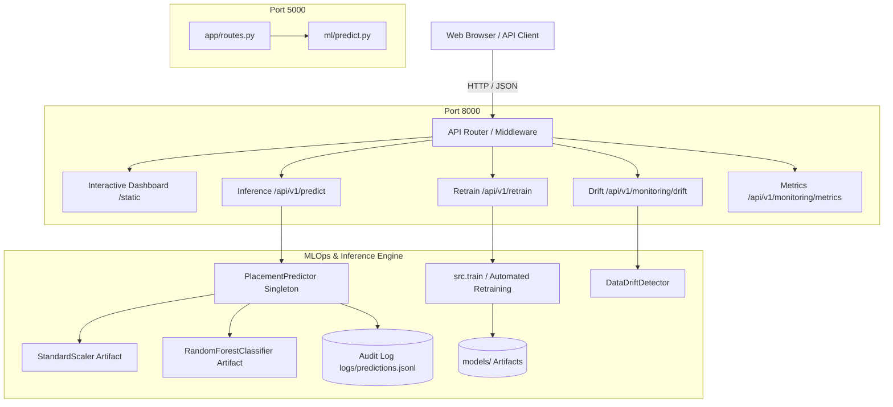
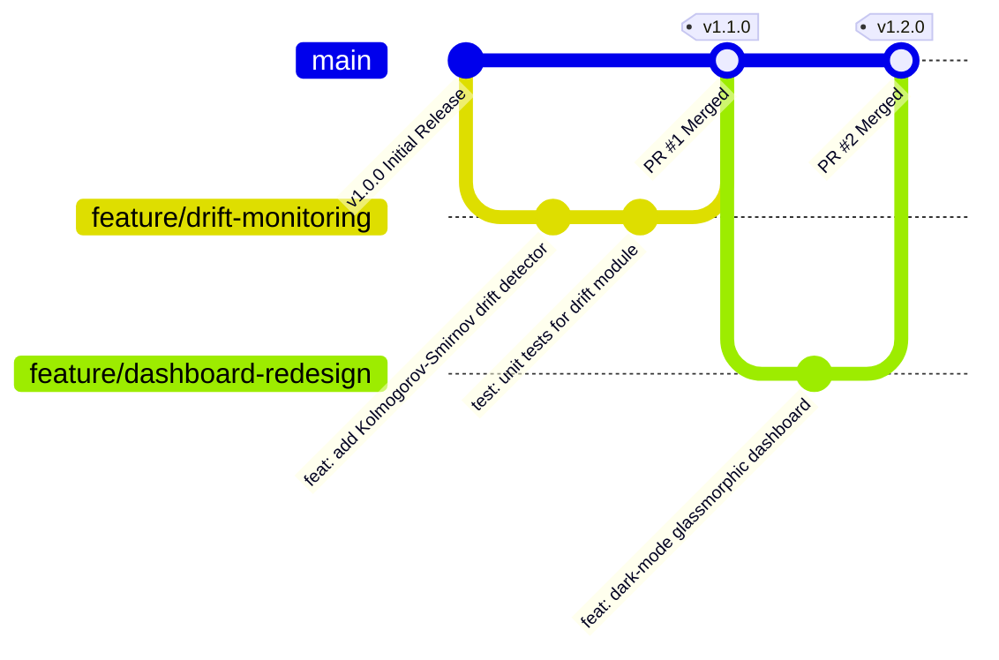

# 🎓 Student Placement Prediction System with MLOps

[](https://www.python.org/)
[](https://fastapi.tiangolo.com/)
[](https://flask.palletsprojects.com/)
[](https://scikit-learn.org/)
[](https://docs.pytest.org/)
[]()
[](LICENSE)

An end-to-end, reproducible **Student Campus Placement Prediction System with MLOps** developed for modern software engineering and DevOps/MLOps workflows. The system features a reproducible scikit-learn machine learning pipeline with automated data generation, stratified train/test splitting, baseline benchmarking, data drift detection, automated retraining hot-reload, comprehensive input validation, 44 automated pytest tests, and a modern, dark-mode real-time analytics web dashboard.

---

## 📑 Table of Contents
1. [Project Highlights](#-project-highlights)
2. [Setup & Installation](#-setup--installation)
3. [System Architecture](#-system-architecture)
4. [API Usage & Documentation](#-api-usage--documentation)
5. [Automated Testing & QA](#-automated-testing--qa)
6. [Project Limitations & Ethical Considerations](#-project-limitations--ethical-considerations)
7. [Git & GitHub Branching Strategy](#-git--github-branching-strategy)

---

## 📌 Project Highlights

- **Dual-Stack Inference Engines**:
  - **Primary**: High-performance asynchronous FastAPI API with Swagger docs (`/docs`) and real-time dashboard on port `8000`.
  - **Secondary / Legacy**: Minimalist Flask REST server on port `5000`.
- **7 Core Academic & Placement Features**:
  1. `cgpa`: Cumulative Grade Point Average (`0.0 – 10.0`)
  2. `technical_score`: Coding proficiency & CS fundamentals (`0 – 100`)
  3. `aptitude_score`: Quantitative & logical reasoning (`0 – 100`)
  4. `communication_score`: Soft skills & verbal proficiency (`0 – 100`)
  5. `internships`: Practical industry experience count ($\ge 0$)
  6. `projects`: Portfolio projects completed ($\ge 0$)
  7. `attendance`: Lecture & laboratory attendance percentage (`0 – 100%`)
- **Actionable Student Analytics**: Returns placement classification (`Likely` or `Unlikely`), calibrated probability percentage, confidence rating, key influential factors, and personalized academic recommendations.
- **MLOps Lifecycle Features**:
  - Reproducible `StandardScaler` + `RandomForestClassifier` pipeline.
  - Baseline comparison against `DummyClassifier` (majority class) and `LogisticRegression`.
  - Data drift detection module evaluating production feature distributions.
  - Automated zero-downtime model retraining hot-reloader (`POST /api/v1/retrain`).
  - Audit logging of inference queries with UUIDs to `logs/predictions.jsonl`.
- **Comprehensive Quality Assurance**: 44 automated tests covering validation boundaries, predictions, REST APIs, baseline benchmarks, and missing artifact recovery.

---

## 🚀 Setup & Installation

### 1. Prerequisites
- **Python**: Version `3.10` or higher (Python `3.11` recommended)
- **Git**: Installed and configured
- **pip**: Latest Python package manager

### 2. Clone the Repository
```bash
git clone https://github.com/<your-username>/student-placement-mlops.git
cd student-placement-mlops
```

### 3. Virtual Environment Setup

**On Windows (PowerShell):**
```powershell
# Create virtual environment
python -m venv .venv

# Activate virtual environment
.\.venv\Scripts\Activate.ps1
```
*(If script execution is disabled in PowerShell, run `Set-ExecutionPolicy -ExecutionPolicy RemoteSigned -Scope Process` first)*

**On macOS / Linux (Bash):**
```bash
# Create virtual environment
python3 -m venv .venv

# Activate virtual environment
source .venv/bin/activate
```

### 4. Install Dependencies
```bash
pip install --upgrade pip
pip install -r requirements.txt
pip install -r requirements-dev.txt
```

### 5. Environment Configuration
Copy the provided environment template to `.env`:
```bash
# Windows PowerShell:
Copy-Item .env.example .env

# Linux / macOS:
cp .env.example .env
```
*(Note: `.env` is ignored by Git to safeguard local configurations and secrets)*

### 6. Run the Application

Using the Windows PowerShell helper script:
```powershell
# Launch FastAPI server & interactive Web Dashboard on http://127.0.0.1:8000
.\run.ps1 serve

# Retrain model pipeline
.\run.ps1 train

# Run automated test suite
.\run.ps1 test

# Run code linter
.\run.ps1 lint
```

Or manually with Uvicorn:
```bash
python -m uvicorn src.app:app --host 127.0.0.1 --port 8000 --reload
```

---

## 🏗️ System Architecture

### Component Architecture Diagram



### Directory Tree Overview

```
student-placement-mlops/
├── .github/                      # GitHub Actions CI/CD workflows
│   └── workflows/
│       ├── ci-cd.yml             # Lint, test, build pipeline
│       └── model-retrain.yml     # Automated scheduled retraining
├── app/                          # Flask application package (Secondary engine)
│   ├── routes.py                 # Flask REST endpoints
│   ├── validators.py             # Form validation & error handlers
│   └── static/                   # Minimalist dashboard UI
├── data/
│   ├── raw/                      # Raw placement training dataset
│   └── processed/                # Reproducible stratified train/test splits
├── docs/                         # Technical documentation & guides
│   ├── AGILE_SCRUM_GUIDE.md      # Agile methodology alignment
│   ├── DEVOPS_MLOPS_PIPELINE.md  # DevOps & CI/CD specifications
│   └── VIVA_VOCE_PREPARATION.md  # Academic evaluation defense guide
├── logs/                         # Runtime logs (ignored by Git via .gitkeep)
├── ml/                           # Scikit-learn Pipeline & Baseline engine
│   ├── config.py                 # Feature definitions & thresholds
│   ├── dataset.py                # Synthetic dataset generation
│   ├── evaluate.py               # Confusion matrix & ASCII metrics
│   ├── pipeline.py               # Preprocessing & baseline models
│   └── predict.py                # Inference helper
├── models/                       # Serialized model artifacts (.joblib, .json)
├── scripts/                      # CLI executables
│   ├── train.py                  # Train and benchmark models
│   ├── evaluate.py               # Print terminal model report
│   ├── generate_data.py          # Data generation script
│   └── run_server.py             # Start Flask dev server (port 5000)
├── src/                          # FastAPI core production application
│   ├── app.py                    # FastAPI server & route definitions
│   ├── config.py                 # Paths, hyper-parameters, constants
│   ├── data_generator.py         # Realistic distribution generator
│   ├── drift_detector.py         # Kolmogorov-Smirnov drift calculator
│   ├── predict.py                # Pydantic schemas & inference
│   └── train.py                  # Train, evaluate, and version model
├── static/                       # Dark-mode Dashboard UI (FastAPI)
│   ├── css/style.css             # Glassmorphism design system
│   ├── index.html                # Semantic UI with charts and gauges
│   └── js/app.js                 # Interactive form, presets & visualizations
├── tests/                        # 44 automated pytest tests
├── .env.example                  # Environment variable template
├── .gitignore                    # Comprehensive exclusion rules
├── Dockerfile                    # Multi-stage container definition
├── docker-compose.yml            # Compose configuration
├── requirements.txt              # Production dependencies
├── requirements-dev.txt          # Testing and linting dependencies
└── run.ps1                       # Windows PowerShell helper script
```

---

## 📡 API Usage & Documentation

When running `src.app:app` on `http://127.0.0.1:8000`:
- **Interactive Swagger Documentation**: [http://127.0.0.1:8000/docs](http://127.0.0.1:8000/docs)
- **ReDoc Documentation**: [http://127.0.0.1:8000/redoc](http://127.0.0.1:8000/redoc)

### 1. Health Check
- **Endpoint**: `GET /health`
- **cURL Request**:
  ```bash
  curl -X GET http://127.0.0.1:8000/health
  ```
- **Response (HTTP 200)**:
  ```json
  {
    "status": "healthy",
    "service": "student-placement-mlops",
    "version": "v1.2.1",
    "uptime_seconds": 153.5,
    "model_loaded": true,
    "algorithm": "RandomForestClassifier"
  }
  ```

### 2. Predict Placement (Single Candidate)
- **Endpoint**: `POST /api/v1/predict`
- **Headers**: `Content-Type: application/json`
- **cURL Request**:
  ```bash
  curl -X POST http://127.0.0.1:8000/api/v1/predict \
    -H "Content-Type: application/json" \
    -d '{
      "cgpa": 8.5,
      "technical_score": 85.0,
      "aptitude_score": 78.0,
      "communication_score": 82.0,
      "internships": 2,
      "projects": 3,
      "attendance": 90.0
    }'
  ```
- **Success Response (HTTP 200)**:
  ```json
  {
    "prediction_id": "a50c82fb-6c17-48f5-a0cf-79ad2cf44b8b",
    "prediction": "Likely",
    "probability": 0.994,
    "probability_percentage": "99.4%",
    "confidence": "High",
    "key_factors": [
      "Exceptional CGPA gives strong academic standing",
      "High technical competence significantly boosts placement odds",
      "Substantial internship track record valued by hiring managers",
      "Rich portfolio of completed practical projects"
    ],
    "recommendations": [
      "Maintain active participation in mock technical interviews and system design."
    ],
    "model_version": "v1.2.1",
    "timestamp": "2026-10-13T06:05:00Z"
  }
  ```

### 3. Model Retraining Trigger
- **Endpoint**: `POST /api/v1/retrain`
- **cURL Request**:
  ```bash
  curl -X POST http://127.0.0.1:8000/api/v1/retrain -H "Content-Type: application/json" -d '{}'
  ```
- **Response (HTTP 200)**:
  ```json
  {
    "status": "success",
    "message": "Model retrained and hot-reloaded successfully.",
    "previous_version": "v1.2.0",
    "new_version": "v1.2.1",
    "accuracy_change": {
      "before": 0.9367,
      "after": 0.9367,
      "delta": 0.0
    },
    "metrics": {
      "accuracy": 0.9367,
      "precision": 0.9385,
      "recall": 0.9828,
      "f1_score": 0.9602,
      "roc_auc": 0.9787
    }
  }
  ```

### 4. Observability & Monitoring Metrics
- **Endpoint**: `GET /api/v1/monitoring/metrics`
- **Response (HTTP 200)**:
  ```json
  {
    "total_requests": 25,
    "likely_predictions": 18,
    "unlikely_predictions": 7,
    "predicted_placement_rate_percent": 72.0,
    "average_latency_seconds": 0.042,
    "automated_retrains_triggered": 1,
    "model_version": "v1.2.1",
    "status": "OPERATIONAL"
  }
  ```

---

## 🧪 Automated Testing & QA

The system includes 44 unit and integration tests executed using `pytest`.

### Run Test Suite
```bash
python -m pytest -v
```

### Run Tests with Coverage Report
```bash
python -m pytest --cov=src --cov=app --cov=ml tests/
```

### Run Code Quality Linter
```bash
flake8 src app tests --max-line-length=127
```

### Run Live End-to-End Test Script
With the server running at `http://127.0.0.1:8000`:
```bash
python tests/test_live.py
```

### Test Coverage Breakdown
- `test_validation.py`: Tests boundary conditions, invalid data types, missing keys, and out-of-range scores.
- `test_predict.py`: Validates model inference logic, probability boundaries, and recommendation generators.
- `test_api.py` & `test_flask_api.py`: Validates REST response payloads, status codes (200, 400, 404, 503), and JSON schemas.
- `test_baseline_comparison.py`: Verifies primary model outperforming dummy baselines.
- `test_missing_artifacts.py`: Asserts graceful error handling and recovery when model weights are missing.

---

## ⚖️ Project Limitations & Ethical Considerations

While designed with MLOps best practices, this software is subject to important real-world boundaries:

1. **Synthetic Educational Simulation Data**:
   - The default model is trained on a synthetic simulation dataset generated to reflect realistic academic distributions for lab and agile development demonstrations.
   - It does not encapsulate macro-economic hiring shifts, industry downturns, or non-linear job market dynamics.
2. **Not a Deterministic Placement Guarantee**:
   - Placement decisions depend heavily on subjective soft factors (culture fit, real-time interview performance, body language, domain specialization, and individual recruiter quotas) that cannot be fully captured by numerical feature scores.
   - Output probabilities represent algorithmic likelihoods, not employment guarantees.
3. **Data Privacy & Student PII Protection**:
   - Real institutional placement databases contain sensitive Personally Identifiable Information (PII) regulated under laws such as FERPA and GDPR.
   - The repository explicitly forbids committing real student identifiers. Any production integration requires data anonymization, strict role-based access control, and encrypted storage.
4. **Algorithmic Fairness & Bias Mitigation**:
   - Academic metrics can exhibit historical bias. Prior to any real institutional deployment, demographic parity and disparate impact audits must be executed to ensure fair outcomes across all candidate backgrounds.

---

## 🌿 Git & GitHub Branching Strategy

To maintain a clean, collaborative, and release-ready repository, this project follows the **GitHub Flow** branching model:



### 1. Branch Strategy Rules
- **`main`**: The protected production branch. Always deployable and tested. Direct commits to `main` should be reserved for initial setup or hotfixes; all features enter via Pull Requests.
- **`feature/<feature-name>`**: Created from `main` for developing new features (e.g., `feature/kafka-streaming`, `feature/shap-explainability`).
- **`fix/<bug-name>`**: Created for fixing identified issues or failing tests.
- **`docs/<topic>`**: Created for non-code documentation enhancements.

### 2. Standard Git Workflow: Step-by-Step

#### Step A: Inspect Current Status
```bash
git status
```

#### Step B: Create a Feature Branch
```bash
git checkout -b feature/model-monitoring-enhancement
```

#### Step C: Stage and Commit Changes
```bash
git add .
git commit -m "feat: enhance model drift detection and update documentation"
```

#### Step D: Connect Your GitHub Remote
*(Replace `<your-username>` with your GitHub handle)*
```bash
git remote add origin https://github.com/<your-username>/student-placement-mlops.git
```

#### Step E: Push Your Branch to GitHub
```bash
# Push your current feature branch
git push -u origin feature/model-monitoring-enhancement

# Or push your main branch
git push -u origin main
```

#### Step F: Open a Pull Request (PR)
1. Go to your GitHub repository in your browser: `https://github.com/<your-username>/student-placement-mlops`.
2. GitHub will display a banner: **"feature/model-monitoring-enhancement had recent pushes"** — click **Compare & pull request**.
3. Fill out the PR template describing the changes, automated test results, and impact.
4. Ensure the GitHub Actions CI/CD check passes.
5. Review and click **Merge pull request** to merge into `main`.

---

## 📄 License
This project is licensed under the MIT License - see the [LICENSE](LICENSE) file for details.
